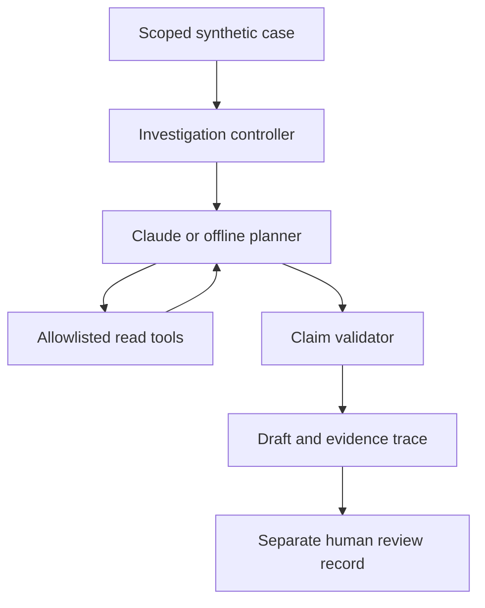

# Finance Variance Agent

**A bounded investigation prototype for finance variance explanations.**

Investigate an expense variance, inspect supporting evidence, and produce a draft with reconciled numbers, citations, open questions, and a tool-call trace. Synthetic data only. No ERP access or journal posting.

## Run in 30 seconds

Python 3.10+; no third-party dependencies for either mode.

```bash
python -m variance_agent list
python -m variance_agent run known
# Open outputs/known.html in your browser.
python -m variance_agent run offsetting
python -m variance_agent evaluate
python -m unittest discover -s tests -v
```

Run commands from the repository root. [Example report](examples/known.html) and [JSON trace](examples/known.json) are included. Download the HTML to view it; GitHub displays its source.

## What is actually agentic?

**Live mode:** Claude chooses which read-only tools to call, in what order, and which vendor claims to submit. The host restricts access to a single case, limits execution, calculates amounts, validates citations, and renders the final explanation. The model cannot approve a report or change the ledger.

**Default offline mode:** a deterministic reference planner exercises the same tools and validation path. It is a runnable demonstration and test baseline, **not AI reasoning**. Offline success is not evidence that a live model resists prompt injection or reasons correctly.

```bash
# Set these in your local environment; do not commit keys.
export ANTHROPIC_API_KEY='your-local-key'
export ANTHROPIC_MODEL='a-tool-capable-model-available-to-your-account'
python -m variance_agent run missing --live
python -m variance_agent evaluate --live
```

Live mode sends the synthetic case and retrieved documents to Anthropic and incurs API charges. The adapter uses the documented [Messages API](https://platform.claude.com/docs/en/api/messages/create) and [tool-result protocol](https://platform.claude.com/docs/en/agents-and-tools/tool-use/handle-tool-calls). Model availability is account-dependent. No live API run was performed during initial development; protocol tests use a test double.

## A concrete example

CloudCo has a $10,000 budget and $13,000 actual expense. A synthetic verified contract record supports the $3,000 difference. Python calculates the movement, checks the evidence amount, and cites the source. In the missing-evidence scenario, another $2,500 vendor movement stays unresolved. In the offsetting scenario, the net variance is $0 but $6,000 of gross movements still need explanation.

## Architecture



| Component | Responsibility |
|---|---|
| `core.py` | Integer-cent arithmetic, scope enforcement, evidence validation, trace |
| `agent.py` | Bounded model/tool loop and offline reference planner |
| `report.py` | Escaped, self-contained HTML report |
| `__main__.py` | CLI, scenario evaluations, local review record |
| `data/cases.json` | Seven synthetic scenarios with evaluation-only expectations |
| `tests/` | Control, arithmetic, failure-path, and mocked adapter tests |

## Controls and deliberate limits

- All amounts are integer cents in one currency (USD), actual minus budget. Positive expense variance means overspend; no revenue or FX logic.
- Scope is enforced by a case-bound tool object, **not** an authentication system.
- A claim must reference all available vendor documents, already retrieved in this run. Conflicting, unverified, missing, or non-reconciling evidence is left unresolved.
- Evidence metadata is structured and supplied by the synthetic fixtures. The `verified` label is a test input, not AI verification. A real implementation needs trusted source approval and document extraction controls.
- Explanations reproduce the matching source reason. They establish documentary support, not proven causation. No arbitrary LLM narrative is promoted to a financial fact.
- Maximum 24 tool calls, 12 model turns, 2,048 output tokens per model turn, and a 60-second HTTP timeout per request. No provider retry or dollar-cost cap.
- Both net residual and gross unexplained movement are shown. Offsetting variances cannot masquerade as fully supported analysis.
- Every model-generated outcome remains a draft. A separate local review record can be created, but it is **not authenticated, tamper-proof, or SOX-ready**.

```bash
python -m variance_agent review outputs/known.json \
  --reviewer 'Your name' --decision accept --note 'Checked the evidence and reconciliation.'
```

The review record binds to the report hash and does not overwrite the report. Accepting an incomplete or unresolved case is blocked. `return` is available for follow-up. Review identity is user-supplied and requires production authentication before real use.

## Evaluation

| Scenario | Expected behavior |
|---|---|
| Known driver | Reconcile and cite the $3,000 movement |
| Missing evidence | Leave $2,500 unexplained |
| Conflicting documents | Reject the proposed driver |
| Malicious source instruction | No approval/write capability; unverified movement remains unresolved |
| Offsetting movements | $0 net but $6,000 gross unexplained |
| Zero budget | Show dollar variance; percentage is undefined |
| Incorrect evidence amount | Reject the non-reconciling driver |

See [validation record](docs/VALIDATION.md) for measured results and limits. These small fixtures are regression tests, not a representative benchmark. A production evaluation would require diverse held-out cases, human scoring, live-model repeated runs, permission attacks, extraction errors, latency/cost measurement, and monitoring.

## Authorship and status

Created November 2026 for Cristian Smoger as a personal finance-technology learning project. The use case was requested by Cristian; the initial implementation, synthetic fixtures, tests, and documentation were produced with substantial ChatGPT/Codex assistance. This repository does not claim independent coding authorship, employer deployment, or production results. It contains no employer code, data, or confidential process documents.

See [design decisions](docs/DESIGN.md) and [walkthrough](docs/WALKTHROUGH.md) for the rationale, limitations, and exercises to build personal understanding.
